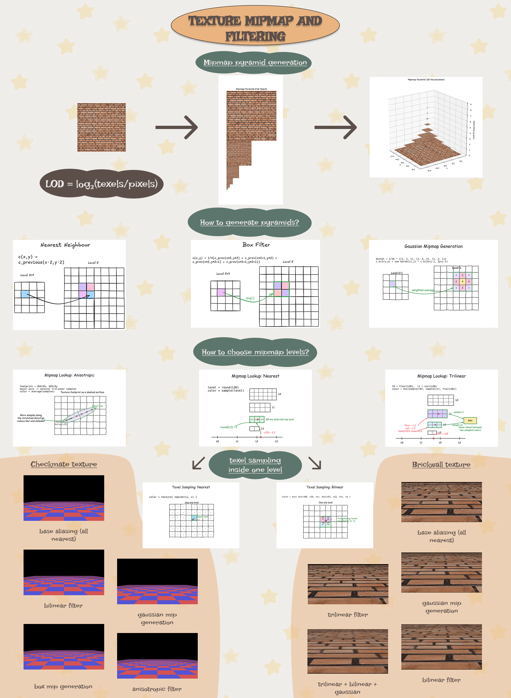
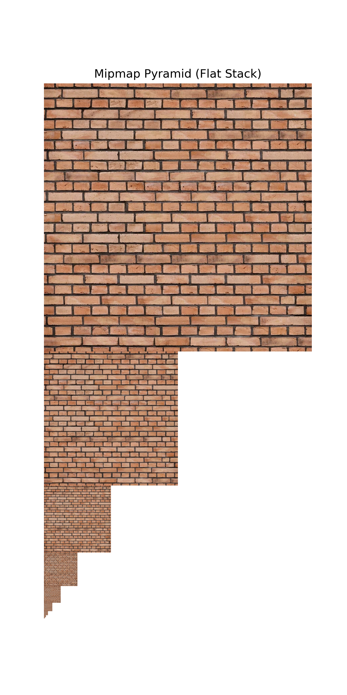
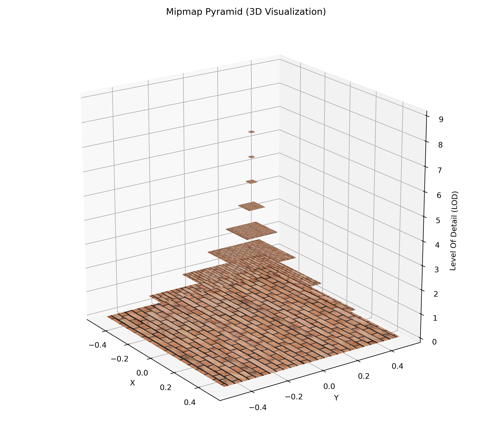

# Mipmap Filtering for 3D Textured Rendering

This project was developed as part of a 3D graphics course and focuses on one of the most important techniques used in real-time rendering: mipmapping and texture filtering.

The goal was to build a small graphics pipeline from scratch in Python and study how different texture sampling strategies affect image quality and performance, especially when objects appear at different distances from the camera.

## Project idea

The renderer loads simple 3D meshes, projects them into screen space, rasterizes triangles, applies lighting, and samples textures using various filtering modes. The project explores:

- perspective projection and camera transforms
- triangle rasterization and depth testing
- texture mapping on 3D surfaces
- mipmap generation from a source texture
- nearest, bilinear, trilinear and anisotropic filtering
- visual comparison of rendering quality at different levels of detail

## Why mipmaps matter

When a textured object is far away, a single high-resolution texture may be sampled at a very small scale. This causes aliasing, blur, and visible artifacts. Mipmaps solve this by precomputing a pyramid of progressively lower-resolution versions of the texture and choosing the most appropriate level for a given screen footprint.

This project demonstrates how different mipmap methods and sampling techniques affect the final image, especially on checkerboard and brick-wall textures.

## Main components

- `main.py` : entry point that creates a camera, projection, and rasterizer pipeline and renders a textured quad
- `graphicPipeline.py` : custom rasterization pipeline, mipmap generation, texture sampling, and fragment shading
- `pipelineVisual.py` : generates visualizations of the mipmap stack and 3D pyramid
- `camera.py` and `projection.py` : camera and projection math
- `readply.py` and `.ply` model files : mesh loading and example geometry
- `checkerboard.png`, `brickwall.png` : test textures

## Features implemented

- custom 3D rendering pipeline in Python
- camera and perspective projection
- linear interpolation and barycentric rasterization
- depth buffer for hidden surface removal
- Phong-style lighting approximation
- texture sampling with nearest and bilinear texel lookup
- mipmap generation using nearest, box, and Gaussian downsampling
- trilinear and anisotropic LOD-based sampling

## Visual results

The project includes several generated images that show both the technical process and final results. The most complete summary is the poster image:



Visualizations in better quality:





These images help explain how the texture is reduced across mipmap levels and how different filtering strategies behave visually.

## How to run

From the repository root:

```bash
python main.py
```

This renders the textured scene using the custom pipeline. To generate the mipmap visualizations:

```bash
python pipelineVisual.py
```

## Course context

This work was created for a 3D graphics course and serves as a practical exploration of texture sampling and mipmapping in real-time rendering. It is a small but complete implementation of the core ideas behind modern graphics pipelines, with a strong focus on how image quality is preserved across varying distances and screen scales.

## Summary

In short, this project is a compact software renderer that turns texture filtering theory into a visible, interactive result. It shows how mipmaps improve rendering quality by adapting texture resolution to the projected size of a surface, and the accompanying poster makes the results easy to understand at a glance.
